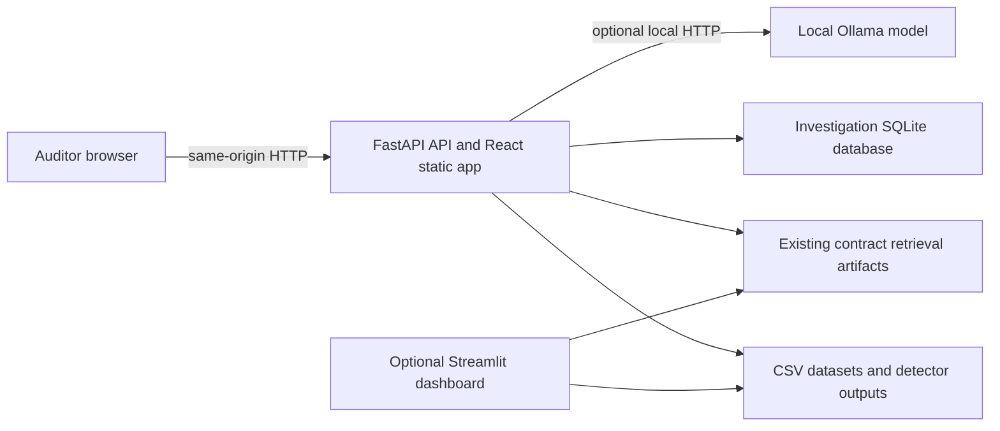

# SentinelP2P

SentinelP2P is a financial audit and intelligence workspace for reviewing
procurement transactions. It brings invoice and vendor records, rules-based
signals, graph-model outputs, contract similarity, and investigation evidence
into one place for human auditors. Automated signals support review; they do
not establish fraud or make payment decisions.

## Features

- React and TypeScript application served by the FastAPI backend.
- Invoice, vendor, and entity-network review workspaces.
- Sentinel AI retrieval and optional local answer generation through Ollama.
- Existing Streamlit dashboard retained for internal experimentation.
- Existing Python investigation workflow and SQLite evidence storage.
- Read-only use of available detection, graph, and contract-retrieval outputs.

Some optional capabilities require their associated local data, artifacts,
dependencies, or services. See [SETUP.md](SETUP.md) before enabling them.

## Architecture



FastAPI serves `frontend/dist` and the `/api/*` routes from the same local
origin. The Vite development server is only needed for frontend development,
not normal use. Ollama answer generation is optional and remains local to the
machine. Vendor external research is a separate investigation capability and
may use Tavily only when explicitly configured; it is not used by Sentinel AI
answer generation.

## Repository layout

```text
backend/                 FastAPI routes, schemas, repositories and services
frontend/                React + TypeScript + Vite application
src/                     Existing shared Python intelligence and investigation modules
data/                    Project data and available detector outputs
test_data/               Small validation fixtures
tests/                   Python tests
scripts/                 Windows PowerShell lifecycle helpers
setup.sh, start.sh,
stop.sh                  Linux setup and lifecycle commands
setup.bat, start.bat,
stop.bat                 Windows launchers for PowerShell helpers
requirements*.txt        Core and optional Python dependency groups
```

## Requirements

- Python 3.10 or newer.
- `uv` for Python dependency/environment management.
- Node.js 20.19+ or 22.12+ with npm.
- Linux: Bash. Windows 10/11: Windows PowerShell 5.1 or newer.
- For local AI answers: Ollama installed separately and a model downloaded
  separately. No GPU is assumed.

Install Python and Node.js using their official distribution channels, and
install `uv` using the [official uv instructions](https://docs.astral.sh/uv/getting-started/installation/).
Use a supported Node.js release from [nodejs.org](https://nodejs.org/en/download/).
The project scripts only check these tools; they do not install or upgrade
system software.

The scripts do not install or upgrade system Python or Node, use `sudo`,
install Ollama, or download models. On a clean checkout, setup creates a
project `.venv` if no active environment or usable `.venv` exists. In an
already active environment, it installs the declared core packages into that
environment and does not replace it.

## Setup and run

Detailed, platform-specific instructions and troubleshooting are in
[SETUP.md](SETUP.md).

Linux:

```bash
./setup.sh
./start.sh
```

Windows Command Prompt:

```bat
setup.bat
start.bat
```

Open `http://127.0.0.1:8000`. Stop the processes started by the scripts with
`./stop.sh` on Linux or `stop.bat` on Windows. The optional Streamlit dashboard
can be installed and started separately; see SETUP.md.

## Optional Ollama setup

Install Ollama using its official instructions for your operating system, start
the local Ollama service, and download a model that fits your machine. Then set
`OLLAMA_MODEL` in the root `.env` to the exact installed model name. The root
`.env.example` documents local defaults. Model selection depends on available
memory and hardware, so this repository does not choose or download a model
automatically. Sentinel AI sends answer-generation requests only to the
configured local Ollama endpoint.

## Configuration and privacy

Setup copies `.env.example` to `.env` only when `.env` is absent. Existing
`.env` files and secrets are preserved. Do not put secrets in frontend
configuration: Vite values are embedded in browser assets. Keep API keys in
the backend environment only. `.env.example` contains placeholders and local
defaults, not credentials.

The application may read locally stored vendor, employee, invoice, contract,
and investigation data. Keep local data and credentials out of public commits.
Runtime logs, process state, environments, local databases, and generated
model outputs are ignored by Git; source/demo CSVs and test fixtures remain
available to a fresh checkout.

## Development and tests

Run the frontend development server only when actively developing the UI:

```bash
cd frontend
npm ci
npm run dev
```

The frontend development server proxies `/api` to FastAPI as configured in
Vite. For production-mode local use, build with `npm run build` from
`frontend/`, then run FastAPI through the setup/start scripts.

Install test dependencies and run Python tests with the project's environment.

Linux:

```bash
uv pip install --python .venv/bin/python -r requirements-dev.txt
.venv/bin/python -m unittest discover -s tests -v
```

Windows:

```powershell
uv pip install --python .venv\Scripts\python.exe -r requirements-dev.txt
.\.venv\Scripts\python.exe -m unittest discover -s tests -v
```

When using an already active environment, replace the interpreter path with
that environment's Python executable.

## Dependency groups

- `backend/requirements.txt`: normal FastAPI application runtime.
- `requirements-dev.txt`: core runtime plus HTTP test client for the Python
  test suite.
- `requirements-streamlit.txt`: optional internal Streamlit dashboard.
- `requirements-ml.txt`: optional data generation, model training, and
  expanded RAG/graph tooling. It is not installed for normal application
  startup.
- `requirements-phase3.txt`: legacy Phase 3 dependency list retained for
  compatibility; use the grouped files above for new installations.

## Known limitations

- The available data and generated artifacts determine which pages and signals
  can return information; a missing source is not a negative finding.
- GNN, RAG, and optional graph capabilities require their compatible artifacts
  and optional dependencies.
- Ollama models have substantial disk and memory requirements and must be
  selected and installed by the user.
- Windows process orchestration is implemented with PowerShell and is covered
  by CI, but GPU-specific ML operation depends on the user's driver and Python
  environment.
- This application is an auditor support tool. Human auditors retain all
  decisions; SentinelP2P does not execute or release payments.

## License and distribution

Review the repository's licensing and data rights before redistributing a
public clone. Do not publish private business records, local credentials,
customer data, or proprietary model artifacts without authorization.
